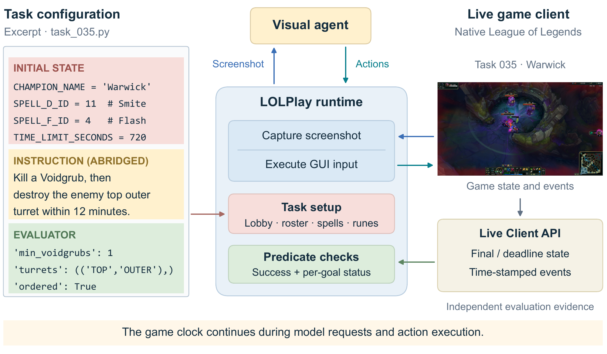
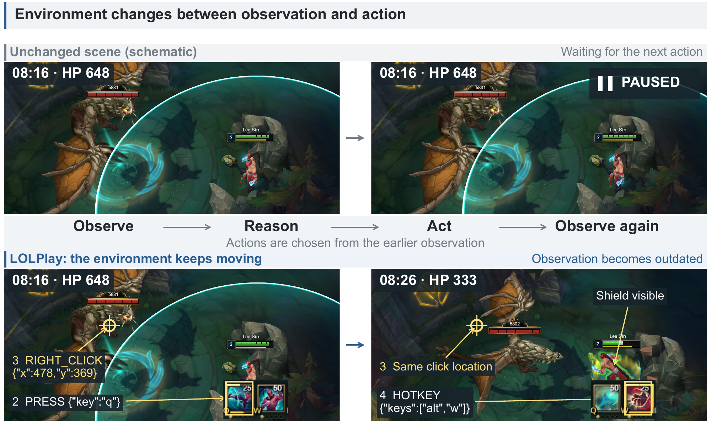
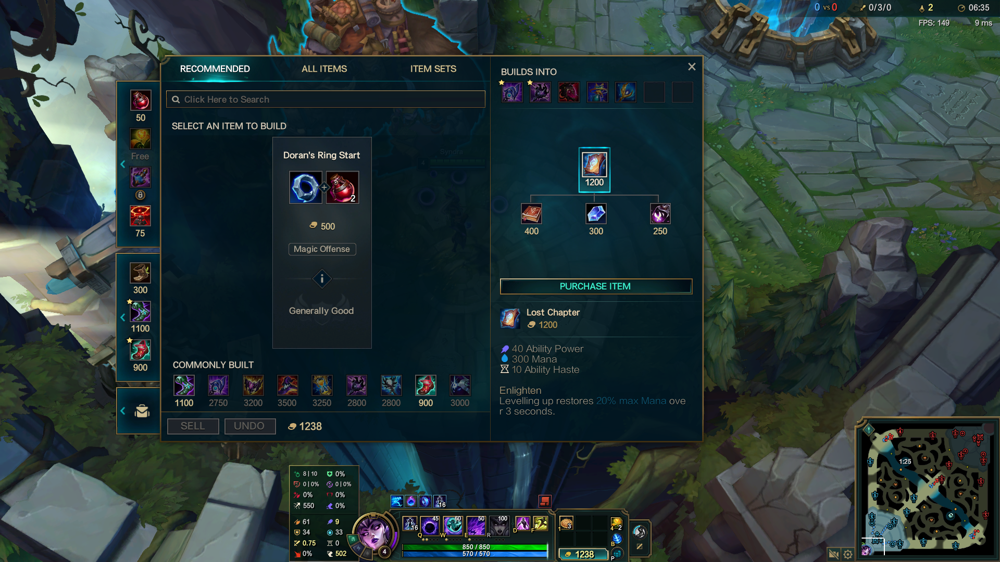
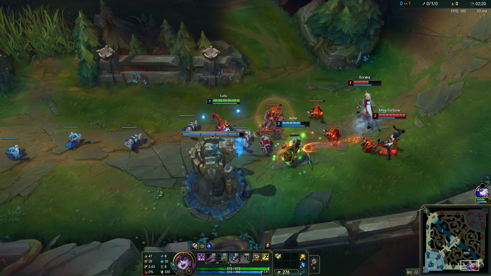
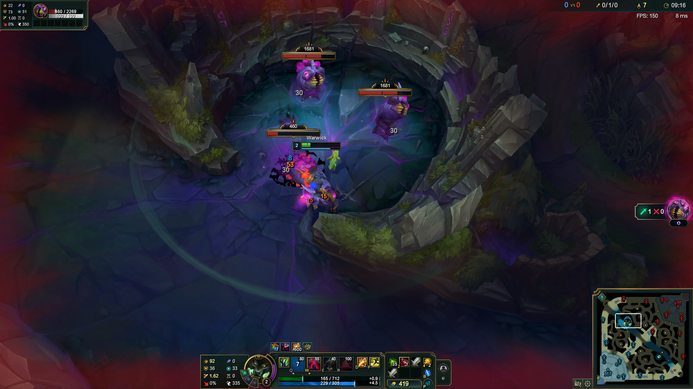

# LOL-Play

**English** | [简体中文](README.zh-CN.md)

[Homepage](https://answers111.github.io/LOL-Play-homepage/)

LOL-Play is a local League of Legends agent evaluation project. It prepares custom games, lets vision agents operate the desktop, and scores gameplay objectives using the Live Client Data API. The project includes 36 tasks across 36 champions and five agent modes.

## Execution and evaluation workflow



The agent chooses mouse and keyboard actions from screenshots. The runtime prepares the game and executes input, while the evaluator independently checks Live Client API states and events. Task035 (Warwick) illustrates the workflow.

[View the original vector figure](assets/overview.pdf)

## Requirements

- Windows with Python 3.10 or newer, PowerShell, and an interactive desktop session.
- A running, signed-in League client with access to the champions and bots required by the selected task.
- Model credentials and an endpoint compatible with the selected agent protocol.

The gameplay integration uses Windows process discovery and input APIs. macOS can be used to read and edit the source; the included gameplay runner targets Windows.

## Quick start

Run these commands from the project root on Windows:

```powershell
python -m pip install -e ".[responses]"
```

Create a local `.env` file:

```dotenv
OPENAI_API_KEY=your_api_key
# Optional: a compatible API endpoint
# OPENAI_BASE_URL=https://your-endpoint/v1
```

Check local configuration, then run a task:

```powershell
python run.py --agent prompt --task task001 --check
python run.py --agent prompt --task task001
```

`--check` constructs the selected agent and desktop environment without starting a game or requesting model actions. It checks local configuration; it does not verify remote model access. A single-task command exits with 0 for task success, 1 for an unsuccessful task, or 2 for a configuration error.

`python run_single_task.py` provides the same single-task CLI. The package distribution and Python imports retain the names `lol-world` and `lolworld_env`.

## Agents

| CLI name | Model output | Conversation and transport |
| --- | --- | --- |
| `prompt` | Python or `computer_13` JSON | Recent screenshot/text history; completed response |
| `prompt-stream` | Python or `computer_13` JSON | Recent screenshot/text history; streaming transport |
| `responses` | Responses computer tool calls | Server response ID history |
| `responses-stateless` | Responses computer tool calls | Full local history; `store=False` |
| `responses-stream` | Responses computer tool calls | Full local history; streaming transport |

The CLI defaults to `responses`, model `gpt-6.1-sol`, and reasoning effort `medium`. These are code defaults; availability depends on your endpoint. Prompt agents select the Anthropic provider for model names beginning with `claude-`; other names select the OpenAI Responses provider. Streaming agents wait for a complete response before executing actions.

For Anthropic prompt agents, install `.[anthropic]` and set `ANTHROPIC_AUTH_TOKEN` (or `CLAUDE_CODE_OAUTH_TOKEN`). Install `.[all]` to include both providers. See the [prompt agent guide](agents/prompt_agent/README.md) and [Responses agent guide](agents/openai_responses/README.md) for configuration and protocol details.

## Real-time interaction



Gameplay continues during model reasoning and action execution, so the scene may change before an action arrives. The top row is an unchanged-scene schematic, not a paused-game experiment. The bottom row shows a Lee Sin interaction; overlays are logged commands, not isolated action effects.

[View the original vector figure](assets/realtime-interaction.pdf)

## Tasks and execution

Tasks cover farming, purchases, skill allocation, champion growth, combat, survival, and map objectives. See the [task catalog](task/README.md) for all 36 objectives and time limits.

```powershell
python run.py --agent prompt-stream --action-space computer_13 --task task001
python run.py --agent responses --task task008 --defense magic_resist
python run.py --agent prompt --task task036 --max-steps 100 --output-dir results
python run_all_tasks_sequential.py --agent prompt --start-id 1 --end-id 3 --check
python run_all_tasks_sequential.py --agent prompt --start-id 1 --end-id 3
```

Batch execution supports `prompt` and `prompt-stream`, runs tasks in numeric order, and creates fresh task, agent, and environment objects for each run.

| Single-task option | Purpose / default |
| --- | --- |
| `--model`, `--base-url` | Select the model and override its provider endpoint |
| `--env-file` | Local environment file; defaults to `.env` beside the entry point |
| `--setup-timeout` | Preparation budget, 600 seconds |
| `--execution-timeout` | Execution cap; defaults to the task limit and cannot extend it |
| `--max-steps` | Maximum prediction rounds, 100 |
| `--position` | `TOP`, `JUNGLE`, `MIDDLE`, `BOTTOM`, `UTILITY`, or `FILL` |
| `--output-dir` | Override the result root, normally `results` |
| `--defense` | Task008 equipment variant: `armor` or `magic_resist` |

Use `python run.py --help` or `python run_all_tasks_sequential.py --help` for the options accepted by each command.

Preparation time is separate from execution time. The runner prepares the game, captures screenshots, calls the agent, executes actions, evaluates the task, saves results, and attempts to leave the custom game. `DONE` ends agent execution; the task evaluator determines success. Deadline capture tasks must run until their deadline. In-flight model requests and Python action blocks may delay stopping.

Preparation sets normal casting for Q/W/E/R, the champion's default skin, summoner spells, and the task's rune configuration. Normal casting persists after the task; the first rune page is overwritten while retaining its name. Required bots and game state are validated before execution.

## Task scenes

| **Economy · Syndra · task036**<br>[](assets/task-036-syndra.png) | **Cooperation · Lulu · task025**<br>[](assets/task-025-lulu.png) | **Map objectives · Warwick · task035**<br>[](assets/task-035-warwick.png) |
| --- | --- | --- |

Screenshots illustrate purchases, bot cooperation, and map objectives; they do not establish task success. See the [task guide](task/README.md) for more examples.

## Results

```text
results/
  experiment-<agent>_<model>_<reasoning-effort>/
    task_001/
      run-<timestamp>-<identifier>/
        trajectory.jsonl
        model_output.jsonl
        agent_result.json
        evaluation.json
        result.json
        step-*.png
    batches/
      all-tasks-<identifier>/summary.json
```

Files depend on how far a run gets. `trajectory.jsonl` contains execution events; `model_output.jsonl` contains model text returned by the endpoint. `agent_result.json` describes execution, `evaluation.json` contains the gameplay score and evidence, and `result.json` combines both. Evaluation includes numbered `target_1`, `target_2`, etc. and a `target_summary`; an unknown target has `achieved: null`. Batch summaries include per-task results and cleanup failures.

## Project structure

| Path | Responsibility |
| --- | --- |
| `run.py` | Task and agent registry, construction, and CLI forwarding |
| `run_single_task.py` | Single-task CLI and callable `run_single_task()` |
| `run_all_tasks_sequential.py` | Sequential batch execution and summary |
| `runner.py` | Prediction/action loop, deadlines, output, and evaluation lifecycle |
| [agents/prompt_agent](agents/prompt_agent/README.md) | Screenshot-to-code/JSON agents and provider adapters |
| [agents/openai_responses](agents/openai_responses/README.md) | Responses computer tool agents and OpenAI OAuth handling |
| [desktop_env](desktop_env/README.md) | Screenshot capture, input execution, and window focus |
| [lolworld_env](lolworld_env/README.md) | Client operations, live data, and evidence parsing |
| [task](task/README.md) | Game preparation, objectives, and evaluators |
| `examples/initialize_match.py` | Example of composing environment operations |

## Extending the project

An agent implements `predict(instruction, obs)` and returns `(response, actions)`. It may implement `step(action)`; otherwise the runner executes Python action strings through `DesktopEnv.step()`. Register its constructor in `run.AGENTS`.

A task implements `setup()` and `evaluate()` on `BaseTask`, defines its instruction and deadline, and is registered as a class in `run.TASKS`. Environment helpers expose client operations and evidence; each task owns its success rules.

Desktop actions execute Python in the local process. Keep credentials outside version control, use agents you trust, and keep the game window available for input. Client updates can affect champion, bot, item, rune, and event compatibility.
