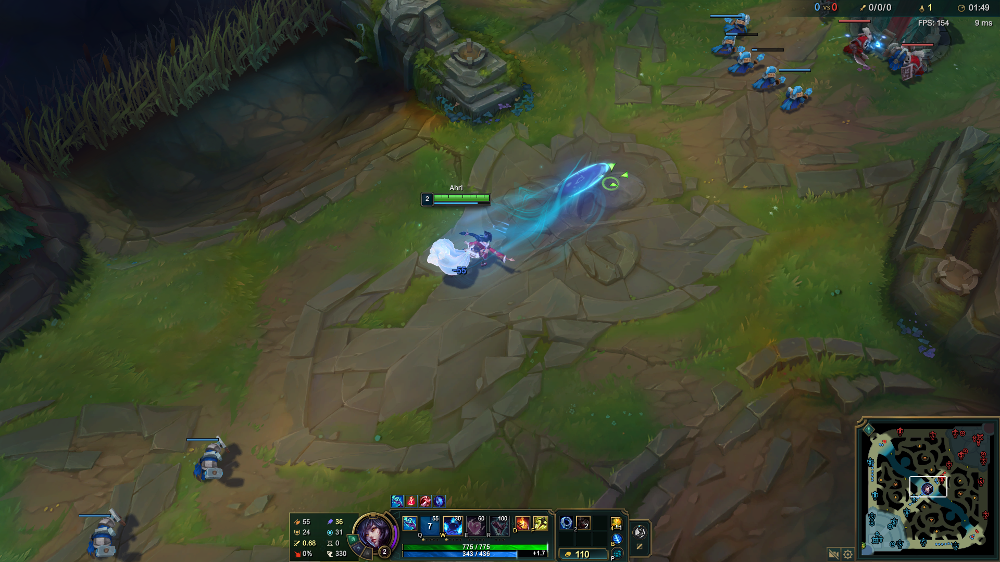

# 桌面执行环境

[English](README.md) | **简体中文**

`DesktopEnv` 为 LOL-Play 智能体获取截图并执行本地桌面动作，独立于模型供应商和任务评分。游戏输入和窗口管理面向 Windows。

## 使用方式

在项目根目录安装 `.[responses]` 等依赖组后运行：

```python
from desktop_env import DesktopEnv

env = DesktopEnv()
env.bind_window("League of Legends (TM) Client")
obs = env.get_obs()  # {"screenshot": PNG 字节}
obs, reward, terminated, info = env.step(
    "pydirectinput.press('p', duration=0.08)"
)
```

`bind_window(title)` 要求恰好一个匹配的游戏窗口，并在输入前检查前台焦点。`get_obs()` 使用 PyAutoGUI 截取桌面。坐标使用截图的绝对像素。

## 截图观察示例



智能体读取包含英雄、兵线、技能栏与小地图的完整画面，并使用截图绝对像素坐标操作。示例展示 Task009 的交互场景，不代表任务完成。

## 动作接口

`step(action, sleep_after_execution=0.0)` 接收 Python 字符串和 `WAIT` / `DONE` / `FAIL` 标记。执行命名空间提供 `pyautogui`、`pydirectinput` 和 `time`。每个 Python 块使用独立命名空间。代码直接在本地进程中执行，环境不是代码沙箱。

环境要求安装 `pydirectinput-rgx`，导入名为 `pydirectinput`，以支持扫描码键盘输入。Prompt Python 动作的鼠标使用 PyAutoGUI，键盘使用 pydirectinput。Responses 和 `computer_13` 动作的移动、拖拽和滚动使用 PyAutoGUI，点击及键盘使用 pydirectinput。Unicode 文本通过 pyperclip 粘贴。

`computer_13` JSON 字典由 Prompt 智能体校验并转换后交给环境：

```python
from agents.prompt_agent import PromptAgent

agent = PromptAgent(env, action_space="computer_13")
agent.step({"action_type": "PRESS", "parameters": {"key": "q", "duration": 0.08}})
```

返回的 reward 默认为零，游戏成功与否由任务评价器判断。

## 窗口生命周期

`game_windows()` 和 `game_process_ids()` 查询游戏窗口和进程。`exit_game()` 通过绑定的游戏窗口退出对局。`clear_stale_game(client)` 检查客户端状态后清理残留游戏进程。运行器负责每个任务前后的准备和清理。

本模块提供内置智能体需要的截图 / step 接口，不包含 OSWorld 虚拟机管理或完整环境 API。

参见[项目说明](../README.zh-CN.md)、[Prompt 智能体](../agents/prompt_agent/README.zh-CN.md)和[任务说明](../task/README.zh-CN.md)。
