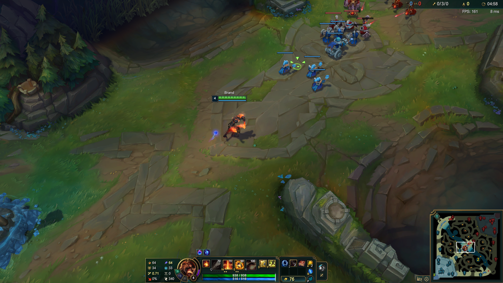
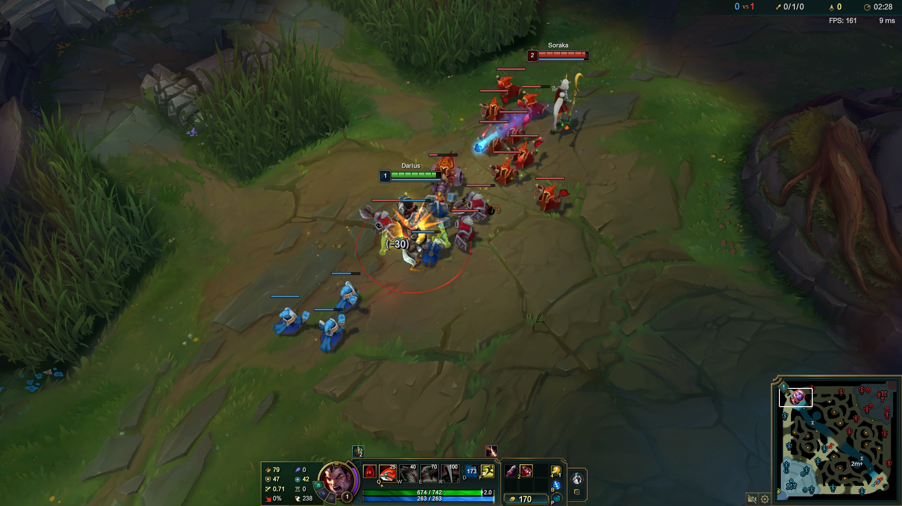

# 游戏任务

[English](README.md) | **简体中文**

任务包定义 36 个英雄自定义对局目标。每个 `TaskNNN(BaseTask)` 独立负责任务准备、指令、执行时限和评价。导入任务不会启动游戏。

## 运行任务

配置智能体后，在项目根目录执行：

```powershell
python run.py --agent prompt --task task001 --check
python run.py --agent prompt --task task001
python run.py --agent responses --task task008 --defense magic_resist
python run_all_tasks_sequential.py --agent prompt --start-id 1 --end-id 3
```

命令行使用 `task001` 至 `task036`，任务元数据和结果目录使用 `task_001` 至 `task_036`。

## 代表任务画面

| **经济 · 辛德拉 · task036**<br>[](../assets/task-036-syndra.png) | **成长 · 阿狸 · task009**<br>[](../assets/task-009-ahri.png) | **续航 · 布兰德 · task016**<br>[](../assets/task-016-brand.png) |
| --- | --- | --- |

| **战斗 · 德莱厄斯 · task022**<br>[](../assets/task-022-darius.png) | **协作 · 璐璐 · task025**<br>[](../assets/task-025-lulu.png) | **地图目标 · 沃里克 · task035**<br>[](../assets/task-035-warwick.png) |
| --- | --- | --- |

六个场景分别展示经济、成长、续航、战斗、协作与地图目标。点击图片可查看原始分辨率。截图用于说明交互场景，不代表目标已经达成；成功条件以各任务评价器为准。

## 任务目录

补刀为 API 返回的总补刀数，包含小兵和野怪。一个任务所列条件需要全部满足。装备条件检查当前库存，属性增长以成功准备时的快照为基线。精确评价规则见链接的任务源码。

| 任务 / 源码 | 英雄 | 成功条件 | 分钟 |
| --- | --- | --- | --- |
| [task001](task_001.py) | 凯特琳 | 补刀 ≥ 30 | 10 |
| [task002](task_002.py) | 李青 | 亲自击杀首条元素龙 | 10 |
| [task003](task_003.py) | 吉格斯 | 摧毁敌方中路一塔 | 10 |
| [task004](task_004.py) | 赛恩 | 截止时最大生命值 ≥ 2000 | 10 |
| [task005](task_005.py) | 韦鲁斯 | 补刀 ≥ 10；十字镐（1037） | 7 |
| [task006](task_006.py) | 莫德凯撒 | 补刀 ≥ 10；增幅典籍（1052）和红水晶（1028） | 8 |
| [task007](task_007.py) | 娑娜 | 等级 ≥ 4；蓝水晶（1027）、鞋（1001）；当前金币 ≥ 300 | 8 |
| [task008](task_008.py) | 拉莫斯 | 等级 ≥ 3；指定防御组件和鞋（1001） | 8 |
| [task009](task_009.py) | 阿狸 | 补刀 ≥ 10；等级 ≥ 4；Q2/W1/E1/R0 | 7 |
| [task010](task_010.py) | 凯尔 | 补刀 ≥ 10；等级 ≥ 6；R ≥ 1 | 9 |
| [task011](task_011.py) | 盖伦 | 补刀 ≥ 10；等级 ≥ 4；Q/E ≥ 1；W = 0 | 7 |
| [task012](task_012.py) | 维迦 | 补刀 ≥ 10；法强增加 ≥ 40 | 8 |
| [task013](task_013.py) | 科加斯 | 等级 ≥ 6；R ≥ 1；最大生命值增加 ≥ 350 | 9 |
| [task014](task_014.py) | 艾希 | 补刀 ≥ 20；短剑（1042）；攻速 ≥ 0.9 次/秒 | 8 |
| [task015](task_015.py) | 蕾欧娜 | 等级 ≥ 4；布甲（1029）和抗魔斗篷（1033） | 8 |
| [task016](task_016.py) | 布兰德 | 截止时补刀 ≥ 20；法力比例 ≥ 50% | 8 |
| [task017](task_017.py) | 蒙多医生 | 截止时补刀 ≥ 20；存活；生命比例 ≥ 80% | 8 |
| [task018](task_018.py) | 索拉卡 | 等级 ≥ 5；补刀 < 20 | 8 |
| [task019](task_019.py) | 拉克丝 | 补刀 ≥ 20；W = 0 | 8 |
| [task020](task_020.py) | 凯南 | 补刀 ≥ 20；等级 ≥ 4；无死亡 | 8 |
| [task021](task_021.py) | 希维尔 | 截止时补刀 ≥ 10；无死亡 | 8 |
| [task022](task_022.py) | 德莱厄斯 | 亲自击杀指定敌方机器人 ≥ 1 次；死亡 ≤ 1 | 9 |
| [task023](task_023.py) | 崔丝塔娜 | 补刀 ≥ 10；亲自击杀指定机器人 ≥ 1 次；十字镐（1037） | 9 |
| [task024](task_024.py) | 墨菲特 | 等级 ≥ 5；死亡 ≤ 1；布甲（1029）和鞋（1001） | 9 |
| [task025](task_025.py) | 璐璐 | 助攻己方艾希击杀 ≥ 1 次；死亡 ≤ 1 | 10 |
| [task026](task_026.py) | 诺提勒斯 | 助攻己方艾希击杀 ≥ 2 次；等级 ≥ 5 | 10 |
| [task027](task_027.py) | 约里克 | 依次摧毁敌方上路一塔、二塔 | 20 |
| [task028](task_028.py) | 贾克斯 | 摧毁敌方上路和中路一塔，顺序不限 | 20 |
| [task029](task_029.py) | 安妮 | 亲自击杀索拉卡 ≥ 2 次；死亡 ≤ 1 | 10 |
| [task030](task_030.py) | 泰隆 | 亲自击杀艾希 ≥ 1 次；无死亡 | 5 |
| [task031](task_031.py) | 卡特琳娜 | 亲自分别击杀厄运小姐、索拉卡 ≥ 1 次；死亡 ≤ 2 | 10 |
| [task032](task_032.py) | 赵信 | 独立击杀参与 ≥ 3 次，含本人击杀和助攻艾希击杀；死亡 ≤ 2 | 12 |
| [task033](task_033.py) | 德莱文 | 截止时补刀 ≥ 40；当前金币 ≥ 1500；存活 | 10 |
| [task034](task_034.py) | 瑞兹 | 截止时等级 ≥ 7；补刀 ≥ 40；法力比例 ≥ 60%；存活 | 10 |
| [task035](task_035.py) | 沃里克 | 亲自击杀巢虫 ≥ 1，随后摧毁敌方上路一塔 | 12 |
| [task036](task_036.py) | 辛德拉 | 库存持有遗失的章节（3802） | 7 |

## 对局准备和设置

任务创建召唤师峡谷自定义对局，验证英雄、地图、模式、阵容和初始数据。准备时间不计入执行预算。各模块定义自己的分路、召唤师技能、符文和房间名。

准备会启用 Q/W/E/R 普通施法，并设置英雄默认皮肤。第一个符文页会被覆盖并选中，保留页名；缺失或不可编辑时会报错。普通施法设置在任务结束后保留。可通过 `--position` 覆盖分路偏好，但不会强制游戏内路线。

Task008 默认要求布甲（1029）和鞋（1001）。`--defense magic_resist` 将布甲替换为抗魔斗篷（1033）。对应 Python 参数为 `Task008(defense="magic_resist")`。

Task021–024 使用敌方索拉卡机器人。Task025–026 为己方艾希对阵厄运小姐和索拉卡。Task029–032 使用指定战斗机器人；Task032 将三个机器人放在下路，玩家打野。所需机器人使用 `RSBEGINNER` 难度，不可用或未确认添加时准备失败。

## 评分与截止时间

- 评价器返回 `success`、`score`、`reason` 和可获取的游戏证据。仅返回 `DONE` 不代表成功。
- Task004、016、017、021、033、034 在执行截止时保存快照。提前结束不满足它们的截止时间要求。
- 运行器默认采用各任务期限。`--execution-timeout` 可以缩短执行，不能延长目标期限。准备使用独立超时。
- 状态条件使用评分快照，事件条件要求任务时间窗口内的有效证据。模型或评分返回延迟本身不会直接判失败，也不能替代按时完成事件的证据。
- 防御塔目标允许己方小兵最后一击。Task027 要求一塔严格早于二塔。Task035 要求本人 `HordeKill` 早于目标摧塔；先锋击杀和助攻不能替代。
- 战斗目标使用有效的 `ChampionKill` 事件和无歧义玩家身份。Task031 要求两个敌人都击杀；Task032 对同一事件只计一次，并同时要求本人击杀和助攻己方艾希。
- 缺失或无效证据不作为零处理。API 连接错误交给运行器。当前库存不同于购买历史，已出售或升级的装备不满足原装备库存目标。

补刀直接采用 API 计数，下限使用十的整数倍。索拉卡目标为严格小于 20。客户端版本可能影响事件可用性和数据行为，评价器仅依据可验证证据评分。

## Python 接口

```python
from task import Task001

task = Task001(trajectory="results")
task.setup()
# 智能体根据 task.instruction 操作游戏。
result = task.evaluate()
```

需要完整生命周期管理时，使用 [run_single_task.py](../run_single_task.py) 的 `run_single_task(task, agent, env, ...)`，负责准备、运行、保存评价，并在配置了清理回调时执行清理。

## 结果证据

共用运行器将执行与评价分别保存在 `results/experiment-<agent>_<model>_<reasoning-effort>/<task.id>/run-*`。评价可包含等级、补刀、装备、金币、技能、英雄属性、原始及有效事件，以及准备 / 执行计时。

`target_1`、`target_2` 等字段分别展示独立条件，含 `expected`、`actual`、`operator` 和 `achieved`。其状态为 true、false 或表示证据不足的 null。`target_summary` 统计达成、未达成和未知目标数。这些字段描述目标完成情况，整体成绩仍以评价器的 `success` 和 `reason` 为准。

参见[项目说明](../README.zh-CN.md)和[环境操作说明](../lolworld_env/README.zh-CN.md)。
